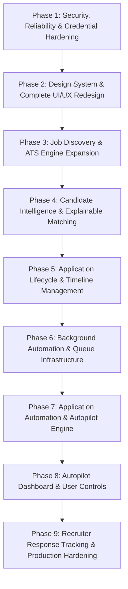

# JobRadar — Comprehensive Implementation Roadmap

> **Document Status:** Active Engineering Roadmap  
> **Target Version:** JobRadar 2.0 (Intelligent Discovery & Autopilot Platform)  
> **Tech Stack Preserved:** React 19 + Vite | Node.js 18+ + Express | MongoDB Atlas + Mongoose | Vercel + Render

---

## 1. Executive Summary & Phasing Strategy

This roadmap details the engineering transition of JobRadar from an ingestion tool into a production-grade, autonomous job discovery, candidate intelligence, and assisted application platform. 

The work is organized into **9 sequential, independently testable phases**:

---

## 2. Phase-by-Phase Implementation Specifications

### Phase 1: Security, Reliability, Credential Hardening & Cleanup
* **Objective:** Eliminate hardcoded credentials, fix authentication gaps, secure administrative endpoints, implement database retention, and resolve technical debt.
* **Key Tasks:**
  1. Remove hardcoded fallback Brevo API key in `backend/services/emailService.js` and development JWT secret in `backend/middleware/authMiddleware.js`. Throw informative startup errors in production if required environment variables are missing.
  2. Protect sensitive/expensive endpoints (`/api/jobs/sync`, `/api/jobs/harvest`, `/api/jobs/fix-urls`, `/api/directory/discover-city`, `/api/directory/scan-google-places`) with `requireAuth` or admin authorization.
  3. Replace hardcoded candidate name (`'Siddharth'`) in `backend/services/cvTailorService.js` with authenticated user attributes or contextual fallback (`'Candidate'`).
  4. Implement IP-based and user-based API rate limiting using an in-memory token bucket middleware across auth and scraping routes.
  5. Add MongoDB retention policies: archive/flag jobs inactive after 90 days of continuous absence, add index for efficient historical run cleanup.
  6. Fix acceptance test harness (`runAcceptanceTests.js`) to support standalone or in-memory API testing when the HTTP server is offline.
* **Affected Files:**
  - `backend/services/emailService.js`
  - `backend/middleware/authMiddleware.js`
  - `backend/routes/jobRoutes.js`
  - `backend/routes/directoryRoutes.js`
  - `backend/services/cvTailorService.js`
  - `backend/utils/rateLimiter.js`
  - `backend/scripts/runAcceptanceTests.js`
  - `backend/server.js`
* **Acceptance Criteria:**
  - Zero hardcoded API keys or fallback secrets present in source.
  - All mutating and scraping endpoints reject unauthenticated requests with HTTP 401.
  - Acceptance tests pass 5/5.

---

### Phase 2: Design System & Complete UI/UX Redesign
* **Objective:** Replace the current utilitarian UI with a unified, SaaS-grade visual experience built on the **Forest Ink (`#173D35`)**, **Warm Sand (`#F3EFE5`)**, and **Muted Copper (`#B47A49`)** palette.
* **Key Tasks:**
  1. Establish CSS design tokens in `frontend/src/index.css` (color scales, typography, spacing, elevations, borders, focus states).
  2. Redesign Information Architecture around 6 core views:
     - **Overview:** Application activity metrics, high-match new postings, critical deadlines, system health.
     - **Discover Jobs:** Real-time job search, multi-facet filtering, rich job details drawer, eligibility breakdown, quick-apply/autopilot trigger.
     - **Applications:** Full 10-stage lifecycle board, timeline tracker, submitted resume snapshots, interview scheduler.
     - **Companies:** Tech directory, verified career portals, physical office corridors, secondary interactive map.
     - **My Career Profile:** Master CV viewer/editor, verified skills, portfolio links, tailored resume history.
     - **Autopilot:** Automation rules, schedule controls, daily quotas, approval requirements, execution audit log.
  3. Integrate `lucide-react` icons uniformly across navigation, metrics, statuses, and action controls.
  4. Build dedicated mobile navigation drawer and responsive bottom bar with independent mobile-first spacing.
* **Affected Files:**
  - `frontend/package.json` (ensure `lucide-react` explicitly declared)
  - `frontend/src/index.css`
  - `frontend/src/App.css`
  - `frontend/src/App.jsx`
  - `frontend/src/components/*`
* **Acceptance Criteria:**
  - Visual system strictly follows Forest Ink, Warm Sand, and Muted Copper palette.
  - Zero purple-blue AI slop gradients or oversized cards.
  - Fully accessible, keyboard-navigable, and responsive across desktop (1440px+), tablet (768px-1024px), and mobile (<480px).
  - Production build succeeds without warnings.

---

### Phase 3: Job Discovery & ATS Engine Expansion
* **Objective:** Expand ATS coverage, build career portal detection, and improve deduplication fidelity.
* **Key Tasks:**
  1. Create a dedicated **Workable Adapter** (`backend/adapters/workable.js`) supporting public Markdown feeds and JSON API.
  2. Create a dedicated **Recruitee Adapter** (`backend/adapters/recruitee.js`) for startups.
  3. Implement **Automatic ATS Detector** (`backend/services/atsDetector.js`) that analyzes career portal HTML/redirects to determine the underlying ATS engine (Greenhouse, Lever, Ashby, Workable, SmartRecruiters, Workday, Eightfold).
  4. Enhance cross-source deduplication: generate robust semantic fingerprints and enforce source precedence (Direct ATS > Company Portal > Aggregator).
  5. Add sync telemetry tracking (`lastSuccessfulSync`, `consecutiveFailures`, `reliabilityScore`) on `Company` model.
* **Affected Files:**
  - `backend/adapters/workable.js` (new)
  - `backend/adapters/recruitee.js` (new)
  - `backend/services/atsDetector.js` (new)
  - `backend/services/autoJobHarvester.js`
  - `backend/scripts/collect.js`
  - `backend/models/Company.js`
  - `backend/models/Job.js`
* **Acceptance Criteria:**
  - Successfully fetches and standardizes jobs from Workable and Recruitee.
  - Career URL scanner correctly identifies ATS engine on sample company domains.
  - Zero duplicate jobs created when same opening exists across multiple feeds.

---

### Phase 4: Candidate Intelligence & Explainable Matching
* **Objective:** Build an end-to-end master candidate profile with explainable dual-factor eligibility scoring and truthful resume tailoring.
* **Key Tasks:**
  1. Create dedicated `MasterProfile` sub-document or model linked to `User` containing verified work experience, projects, education, skills with proficiency, target roles, salary expectations, and residency.
  2. Implement interactive candidate profile editor allowing user verification and manual correction of parsed CV data.
  3. Enhance `eligibilityMatcher.js`:
     - Hard blockers (Country/Work Authorization mismatch, severe under-qualification) explicitly override semantic skill match.
     - Provide clear human-readable explanations ("Why you are a fit" vs "Requirements gap").
  4. Upgrade `cvTailorService.js`:
     - Strictly enforce **truthfulness invariant**: only inject or emphasize keywords candidate actually has evidence for in their master profile.
     - Support master resume vs job-specific tailored resume versioning.
* **Affected Files:**
  - `backend/models/User.js`
  - `backend/services/candidateParser.js`
  - `backend/services/eligibilityMatcher.js`
  - `backend/services/cvTailorService.js`
  - `frontend/src/components/CandidateProfileUploadModal.jsx`
  - `frontend/src/components/CvTailorSection.jsx`
* **Acceptance Criteria:**
  - Candidate can view, edit, and save every extracted field in their profile.
  - Hard blocker reasons always display prominently on non-eligible postings.
  - Tailored resume maintains 100% truthfulness to candidate's verified background.

---

### Phase 5: Application Lifecycle & Timeline Management
* **Objective:** Transition from simple outreach tracking to a complete 10-stage application lifecycle system.
* **Key Tasks:**
  1. Create `Application` MongoDB model with stages:
     `discovered` -> `shortlisted` -> `resume_ready` -> `awaiting_approval` -> `applied` -> `assessment` -> `interview` -> `offer` -> `rejected` -> `withdrawn`.
  2. Store immutable snapshots of submitted resumes (JSON + PDF reference), screening questions answered, confirmation numbers, recruiter contact info, and chronological event logs.
  3. Build comprehensive Application Management view in frontend with Kanban board and list view, stage-change dialogs, and notes.
  4. Migration: seamlessly map existing `UserPipeline` entries to the new `Application` schema without data loss.
* **Affected Files:**
  - `backend/models/Application.js` (new)
  - `backend/controllers/applicationController.js` (new)
  - `backend/routes/applicationRoutes.js` (new)
  - `frontend/src/components/ApplicationsView.jsx` (new)
  - `frontend/src/components/ReachOutView.jsx` (refactor/redirect)
* **Acceptance Criteria:**
  - Full CRUD operations on applications with history logs.
  - Prevent duplicate applications to the same job opening.
  - Backward compatibility preserved for legacy pipeline entries.

---

### Phase 6: Background Automation & Queue Infrastructure
* **Objective:** Implement a resilient, in-process/MongoDB-backed task queue for scheduled ingestion, evaluation, and background operations with retries and dead-letter handling.
* **Key Tasks:**
  1. Build a robust JobQueue service (`backend/services/jobQueue.js`) supporting scheduled and ad-hoc jobs, concurrency limits, exponential backoff, timeout handling, and failure logs.
  2. Implement task workers:
     - `JobIngestionWorker`: Runs scheduled ATS sync and city harvesting.
     - `MatchEvaluationWorker`: Re-scores incoming jobs against active user profiles.
     - `AutopilotExecutionWorker`: Executes approved application tasks.
  3. Add health and queue monitoring endpoint (`/api/admin/queue-status`).
* **Affected Files:**
  - `backend/services/jobQueue.js` (new)
  - `backend/models/QueueTask.js` (new)
  - `backend/server.js`
* **Acceptance Criteria:**
  - Tasks execute with idempotency and recover gracefully from process restarts.
  - Concurrency limits prevent host rate-limiting violations.

---

### Phase 7: Application Automation & Autopilot Engine
* **Objective:** Implement the core Autopilot engine capable of preparing application packets, answering screening questions from candidate data, and executing automated or assisted submissions.
* **Key Tasks:**
  1. Build **Autopilot Engine** (`backend/services/autopilotEngine.js`):
     - Evaluates newly discovered jobs against user's autopilot criteria.
     - Generates tailored resume version and stages application in `awaiting_approval` or `applied` based on user autonomy settings.
     - Synthesizes answers to common ATS screening questions (experience years, current location, notice period, sponsorship needed) strictly from verified profile.
  2. Build **Playwright Automation Worker Architecture** (`backend/workers/browserWorker.js`):
     - Headless browser automation for supported ATS portals (Greenhouse, Lever).
     - Form filling for standard inputs (Name, Email, Phone, Resume File, Links).
     - **Safety Gate & CAPTCHA Protocol**: If CAPTCHA or unanswerable declaration is encountered, halt submission, record DOM state, notify user, and transition application to `awaiting_approval` for assisted completion.
* **Affected Files:**
  - `backend/services/autopilotEngine.js` (new)
  - `backend/workers/browserWorker.js` (new)
  - `backend/models/AutopilotRun.js` (new)
* **Acceptance Criteria:**
  - Successfully pre-fills form fields on sample test ATS application forms.
  - Never submits without user permission when autonomy is set to "Approval Required".
  - Aborts safely without hanging on CAPTCHA challenges.

---

### Phase 8: Autopilot Dashboard & User Controls
* **Objective:** Give the candidate granular control, transparency, and safety over automated operations.
* **Key Tasks:**
  1. Create `AutopilotConfig` model linked to `User` storing:
     - Target role titles, preferred locations, work modes.
     - Minimum match score threshold (e.g., 75%).
     - Daily submission cap (e.g., max 5 applications/day).
     - Mode: `assisted` (prepare & wait for 1-click confirmation) vs `autonomous` (auto-submit supported forms).
     - Blacklisted companies or industries.
  2. Build **Autopilot View** in frontend:
     - Live toggle switch (Active / Paused).
     - Parameter adjustment sliders and tag inputs.
     - Real-time execution log showing matched jobs, prepared packages, and submission receipts.
* **Affected Files:**
  - `backend/models/AutopilotConfig.js` (new)
  - `backend/controllers/autopilotController.js` (new)
  - `backend/routes/autopilotRoutes.js` (new)
  - `frontend/src/components/AutopilotView.jsx` (new)
* **Acceptance Criteria:**
  - User can pause, resume, or adjust autopilot thresholds in real time.
  - Daily submission limits strictly enforced by backend.

---

### Phase 9: Recruiter Response Tracking & Final Hardening
* **Objective:** Optional Gmail integration with explicit OAuth consent for recruiter reply tracking, structured logging, and production readiness.
* **Key Tasks:**
  1. Implement optional Google OAuth flow for Gmail read-only access (`https://www.googleapis.com/auth/gmail.readonly`).
  2. Scan inbound emails matching applied company domains to detect confirmations, rejections, or interview invitations, linking them to the `Application` timeline.
  3. Final production build verification, linting, and acceptance test execution.
* **Affected Files:**
  - `backend/services/emailTrackingService.js` (new)
  - `backend/routes/authRoutes.js`
  - `frontend/src/components/ApplicationsView.jsx`
* **Acceptance Criteria:**
  - Zero email access without explicit, revocable user authorization.
  - Clean production build with zero lint errors.

