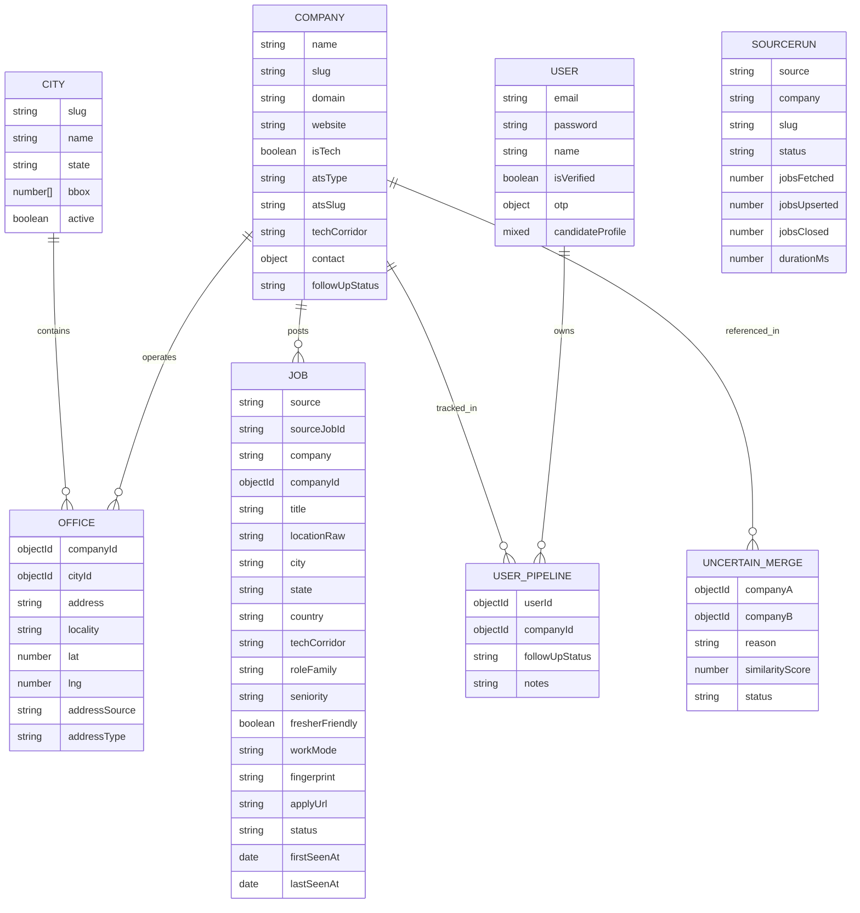

# JobRadar — Comprehensive Technical Architecture & Platform Audit

> **Document Version:** 2.0.0  
> **Audited Date:** November 2026  
> **Status:** Active / Production Audit  
> **Target Audience:** Senior Architects, AI Coding Agents, Full-Stack Engineers

---

## 1. Executive Summary & Architecture Overview

**JobRadar** is a full-stack engineering career search engine, company intelligence directory, and candidate eligibility assessment platform specifically architected for the Indian technology landscape.

Unlike commercial job boards (e.g., Naukri, LinkedIn, Indeed) that suffer from stale listings, duplicate headhunter postings, and sponsored spam, JobRadar operates on a **zero-trust direct-ingestion model**. It ingests postings directly from verified public Applicant Tracking Systems (ATS) and enterprise career endpoints (Greenhouse, Lever, Ashby, SmartRecruiters, Workday, Amazon, Google, Eightfold, and Adzuna India), mapping physical office corridors across 34+ Indian tech capitals and tier-2/3 innovation hubs.

### High-Level Architectural Diagram

```mermaid
flowchart TD
    subgraph ClientLayer ["Frontend Client (React 19 + Vite)"]
        UI["App.jsx (Core Shell)"]
        Tabs["Views: Live Jobs | Company Directory | Outreach Pipeline"]
        Modals["Modals: JobEligibilityModal | CandidateProfileUploadModal | AuthModal | PersonalizeModal"]
        Maps["Leaflet GIS: TechCorridorMapView | DiscoveredPlacesMap"]
        PDF["Client PDF Engine: jspdf (Jake's Resume / Overleaf LaTeX Layout)"]
    end

    subgraph APILayer ["Backend API Gateway (Node.js 18+ / Express 4.21)"]
        Server["server.js (Express Application & Middlewares)"]
        AuthMid["authMiddleware.js (JWT Verification & Cookie Inspection)"]
        JobCtrl["jobController.js (Filters, Pagination, Eligibility, Tailoring)"]
        DirCtrl["directoryController.js (OSM/Google Discovery, Places Autocomplete)"]
        AuthCtrl["authController.js (OTP Generation, Registration, Sessions)"]
    end

    subgraph IngestionLayer ["Ingestion & Automated Harvesters"]
        Cron["In-App Scheduler (node-cron, 6-hr Interval)"]
        GHAction[".github/workflows/sync.yml (Scheduled Cloud Ingestion)"]
        Collector["scripts/collect.js (Idempotent Upsert & Absent Job Closer)"]
        Harvester["services/autoJobHarvester.js (Multi-Hub Autonomous ATS Prober)"]
        Adapters["Adapters: Greenhouse | Lever | Ashby | SmartRecruiters | Workday | Amazon | Google | Eightfold | Adzuna"]
    end

    subgraph IntelligenceLayer ["Rule-Based NLP & Geo Intelligence"]
        Parser["services/candidateParser.js (pdf-parse & Portfolio Scraper)"]
        Analyzer["services/eligibilityAnalyzer.js (Tech Taxonomy & Experience Analyzer)"]
        Matcher["services/eligibilityMatcher.js (Dual-Factor Match Engine)"]
        Tailor["services/cvTailorService.js (Competency Injection & Score Booster)"]
        Geo["utils/corridorResolver.js & geoUtils.js (Polygon Centers & Geo-Dispersion)"]
    end

    subgraph StorageLayer ["Persistence Layer (MongoDB Atlas Cluster)"]
        M_Job[("Job Collection (source + sourceJobId Unique)")]
        M_Company[("Company Collection (domain Unique, isTech, contact)")]
        M_Office[("Office Collection (lat, lng, addressSource, addressType)")]
        M_City[("City Collection (34+ Hubs, Bounding Boxes)")]
        M_User[("User Collection (email, bcrypt password, candidateProfile)")]
        M_Pipeline[("UserPipeline Collection (userId + companyId)")]
        M_Runs[("SourceRun Collection (Scrape Telemetry & Error Metrics)")]
        M_Merge[("UncertainMerge Collection (Fuzzy Deduplication Queue)")]
    end

    subgraph ExternalServices ["External Services & APIs"]
        Brevo["Brevo (Sendinblue) REST API v3 (Transactional Email & OTP)"]
        OSM["OpenStreetMap Overpass API (Kolkata & Pan-India Office Scrapes)"]
        GPlaces["Google Places API / New Text Search (Tech Office Scans)"]
        Photon["Photon Geocoder / Nominatim (Location Autocomplete & Reverse Geo)"]
    end

    UI -->|HTTP / SameSite Cookie / Bearer| Server
    Server --> AuthMid
    AuthMid --> JobCtrl & DirCtrl & AuthCtrl
    JobCtrl --> Parser & Analyzer & Matcher & Tailor
    JobCtrl --> M_Job & M_User
    DirCtrl --> Geo & M_Company & M_Office & M_City & M_Pipeline & M_Merge
    AuthCtrl --> M_User & Brevo

    Cron & GHAction --> Collector & Harvester
    Collector --> Adapters
    Harvester --> Adapters
    Adapters --> M_Job & M_Runs
    DirCtrl --> OSM & GPlaces
    Maps --> Photon
```



---

## 2. Comprehensive Repository Tree & File Inventory

```text
JobRadar/
├── .github/
│   └── workflows/
│       └── sync.yml                         # 6-hourly GitHub Actions scheduled ingestion runner
├── AGENTS.md                                # AI coding agent instructions & invariants
├── package.json                             # Root workspace convenience scripts
├── README.md                                # Public repository milestone overview
├── vercel.json                              # Production Vercel rewrite configuration
│
├── backend/
│   ├── .env                                 # Local development environment configuration (git-ignored)
│   ├── .env.example                         # Reference environment variable template
│   ├── package.json                         # Backend manifests, dependencies, and execution scripts
│   ├── server.js                            # Express server bootstrap, middleware, and cron runner
│   │
│   ├── adapters/                            # Direct career board API adapters
│   │   ├── adzuna.js                        # Adzuna India Job Search API integration
│   │   ├── amazon.js                        # Amazon Jobs JSON search endpoint adapter
│   │   ├── ashby.js                         # Ashby HQ posting API adapter
│   │   ├── eightfold.js                     # Eightfold.ai public candidate API adapter
│   │   ├── google.js                        # Google Careers SSR application payload extractor
│   │   ├── greenhouse.js                    # Greenhouse public board JSON API adapter
│   │   ├── lever.js                         # Lever postings JSON API adapter
│   │   ├── smartrecruiters.js               # SmartRecruiters postings JSON API adapter
│   │   ├── universalFeed.js                 # Dynamic dispatcher routing across ATS engines
│   │   └── workday.js                       # Workday Candidate Experience Site (CXS) adapter
│   │
│   ├── config/                              # Static configuration dictionaries & seed metadata
│   │   ├── companies.json                   # Verified company tokens & ATS engine definitions
│   │   ├── companyCareerPortals.json        # Curated direct company career page URLs
│   │   ├── companyOfficeRegistry.json       # Canonical office locations, corridors, and coordinates
│   │   ├── locationAliases.json             # City, state, and country alias mapping dictionary
│   │   └── techHubCorridors.json            # Tech corridor definitions, centroids, and polygon aliases
│   │
│   ├── controllers/                         # Application route controllers
│   │   ├── authController.js                # Auth, registration, OTP dispatch, session management
│   │   ├── directoryController.js           # Company directory, OSM/Google discovery, places autocomplete
│   │   └── jobController.js                 # Job queries, sync trigger, candidate parsing, CV tailoring
│   │
│   ├── data/                                # Seeds, cached scrape payloads, and data dumps
│   │   ├── cache/                           # Cached OpenStreetMap Overpass responses (34 cities)
│   │   ├── candidateCompanies.json          # Unverified company name & domain candidates
│   │   ├── extracted_blr_companies.json     # Extracted Bengaluru tech companies dataset
│   │   ├── manual_companies.csv             # Manually sourced company directory records
│   │   ├── seeds/
│   │   │   └── techHubSeeds.js              # High-density tech park & enterprise seeds for 34 hubs
│   │   └── unmatched.json                   # Slugs tested against ATS endpoints with 404 results
│   │
│   ├── middleware/
│   │   └── authMiddleware.js                # JWT session verification (requireAuth & optionalAuth)
│   │
│   ├── models/                              # Mongoose schemas & data models
│   │   ├── City.js                          # City registry with geographical bounding boxes
│   │   ├── Company.js                       # Company directory model with tech evidence & contacts
│   │   ├── Job.js                           # Job model with compound unique key (source, sourceJobId)
│   │   ├── Office.js                        # Company office locations with GPS coordinates
│   │   ├── SourceRun.js                     # Ingestion run history, durations, and metrics
│   │   ├── UncertainMerge.js                # Fuzzy company duplicate review queue
│   │   ├── User.js                          # User accounts, hashed passwords, candidate profiles
│   │   └── UserPipeline.js                  # Scoped user outreach pipeline status and private notes
│   │
│   ├── routes/                              # Express route definitions
│   │   ├── authRoutes.js                    # /api/auth routes
│   │   ├── directoryRoutes.js               # /api/directory routes
│   │   └── jobRoutes.js                     # /api/jobs routes
│   │
│   ├── scripts/                             # Operational & maintenance CLI utilities
│   │   ├── backfillJobCountries.js          # Backfills canonical country field on legacy jobs
│   │   ├── collect.js                       # Main idempotent ATS ingestion workflow
│   │   ├── discoverSlugs.js                 # Probes candidate slugs against live ATS APIs
│   │   ├── enrichCityCorridors.js           # Attaches corridor tags to existing company offices
│   │   ├── enrichCompany.js                 # Scrapes company websites for contact details
│   │   ├── enrichExistingJobs.js            # Normalizes seniority and role family on older jobs
│   │   ├── fixSearchApplyUrls.js            # Cleans up malformed job application URLs
│   │   ├── importCsv.js                     # Imports records from manual_companies.csv
│   │   ├── importGurugramStartups.js        # Dedicated seeder for Gurugram tech ecosystem
│   │   ├── importOsm.js                     # Imports OSM offices via Overpass API for cities
│   │   ├── importTechCompaniesAndJobs.js    # Batch importer linking tech companies and jobs
│   │   ├── migrateJobs.js                   # Schema migration script for job records
│   │   ├── purgeGovEntities.js              # Purges mistakenly scraped government/civic entities
│   │   ├── reclassifyJobLocations.js        # Re-evaluates location strings to canonical cities
│   │   ├── runAcceptanceTests.js            # Invariant acceptance verification test suite
│   │   ├── seedCities.js                    # Seeds 34 Indian cities and bounding boxes
│   │   ├── syncJobCompanies.js              # Links orphan Job documents to Company records
│   │   └── unparsedLocations.js             # Reports locations failing regex normalization
│   │
│   ├── services/                            # Core backend domain logic & external integrations
│   │   ├── autoJobHarvester.js              # Autonomous multi-hub ATS probe and ingestion engine
│   │   ├── candidateParser.js               # PDF text extraction and portfolio scraper with SSRF guards
│   │   ├── cvTailorService.js               # Resume tailoring and skill-injection engine
│   │   ├── eligibilityAnalyzer.js           # Taxonomy-based job requirement & experience analyzer
│   │   ├── eligibilityMatcher.js            # Candidate-to-job matching & scoring engine
│   │   ├── emailService.js                  # Brevo REST API v3 transactional email service
│   │   └── googlePlacesService.js           # Google Places API city & tech corridor scanner
│   │
│   └── utils/                              # Shared utility helpers
│       ├── companyUtils.js                  # String similarity, domain extraction, tech filters
│       ├── corridorResolver.js              # Corridor resolution and geo dispersion algorithms
│       ├── geoUtils.js                      # Haversine distance and bounding box calculations
│       ├── normalizeLocation.js             # Text normalization and workMode heuristic classifier
│       └── rateLimiter.js                   # Host-based 1 request/second throttling mechanism
│
└── frontend/
    ├── .env.example                         # Frontend environment template (VITE_API_URL)
    ├── package.json                         # Frontend dependencies (React 19, Leaflet, jsPDF, Vite)
    ├── vite.config.js                       # Vite configuration with local /api dev proxy
    ├── index.html                           # Single-page application HTML entry
    ├── src/
    │   ├── main.jsx                         # Application entrypoint & production fetch interceptor
    │   ├── App.jsx                          # Primary shell orchestrating tabs, filters, and modals
    │   ├── App.css                          # Primary application styles and responsive grid
    │   ├── index.css                        # CSS reset, typography, and theme custom properties
    │   │
    │   ├── context/                         # React context providers
    │   │   ├── AuthContext.jsx              # Authentication, session token, and candidateProfile
    │   │   └── LocationContext.jsx          # GPS coordinates, distance sorting, and tech hubs
    │   │
    │   ├── components/                      # Modular UI components
    │   │   ├── AuthModal.jsx                # Sign-in, sign-up, and OTP verification modal
    │   │   ├── CandidateProfileUploadModal.jsx # CV PDF & portfolio upload modal
    │   │   ├── ClassyDropdown.jsx           # Accessible custom select dropdown
    │   │   ├── CompanyCard.jsx              # Directory company card with hiring tags & actions
    │   │   ├── CompanyDirectory.jsx         # Full directory view with search & OSM/Google triggers
    │   │   ├── CvTailorSection.jsx          # Interactive CV tailoring, editor, and PDF exporter
    │   │   ├── DiscoveredPlacesMap.jsx      # Leaflet map showing discovered company locations
    │   │   ├── JobEligibilityModal.jsx      # Job criteria & personalized candidate match modal
    │   │   ├── PersonalizeModal.jsx         # Cold email generator for unlisted opportunities
    │   │   ├── ReachOutView.jsx             # Outreach pipeline management (Kanban/status lists)
    │   │   ├── TechCorridorMapView.jsx      # Interactive Leaflet map displaying live job clusters
    │   │   ├── UserLocationModal.jsx        # GPS detection & manual tech hub selector
    │   │   └── UserLocationModal.css        # Styles for location picker modal
    │   │
    │   └── utils/                          # Frontend utility libraries
    │       ├── candidateMatcher.js          # Client-side candidate eligibility matching engine
    │       ├── companyOfficeRegistry.js     # Client-side office registry copy for map markers
    │       ├── pdfGenerator.js              # jsPDF single-column LaTeX/Overleaf resume renderer
    │       ├── placeSearchService.js        # Multi-tiered location autocomplete & reverse geocoder
    │       └── useModalScrollLock.js        # Custom hook preventing background scroll on modals
```

---

## 3. Feature Implementation Status Matrix

The following table categorizes all platform features based on rigorous inspection of actual source code:

| Feature / Domain | Implementation Status | Primary Source Files | Notes & Actual Behavior |
| :--- | :--- | :--- | :--- |
| **Multi-ATS Job Ingestion** | **Implemented** | [backend/scripts/collect.js](file:///home/sid/Desktop/JobRadar/backend/scripts/collect.js), [backend/adapters/](file:///home/sid/Desktop/JobRadar/backend/adapters/) | Idempotently ingests Greenhouse, Lever, Ashby, SmartRecruiters, Workday, Amazon, Google, Eightfold, and Adzuna. |
| **Autonomous Job Harvester** | **Implemented** | [backend/services/autoJobHarvester.js](file:///home/sid/Desktop/JobRadar/backend/services/autoJobHarvester.js) | Probes unauthenticated ATS endpoints across 9 major hubs; integrates Workable markdown/JSON. |
| **Idempotent Job Lifecycle** | **Implemented** | [backend/scripts/collect.js](file:///home/sid/Desktop/JobRadar/backend/scripts/collect.js) | Compound key `(source, sourceJobId)`. Absent jobs marked `status: 'closed'` ONLY upon successful fetch. |
| **Location Normalization** | **Implemented** | [backend/utils/normalizeLocation.js](file:///home/sid/Desktop/JobRadar/backend/utils/normalizeLocation.js) | Normalizes raw location strings to canonical city, state, country, and `workMode`. |
| **Corridor Resolution & Geo** | **Implemented** | [backend/utils/corridorResolver.js](file:///home/sid/Desktop/JobRadar/backend/utils/corridorResolver.js) | Maps addresses to tech corridors; applies deterministic hash dispersion for coincident points. |
| **OpenStreetMap Discovery** | **Implemented** | [backend/scripts/importOsm.js](file:///home/sid/Desktop/JobRadar/backend/scripts/importOsm.js), [backend/controllers/directoryController.js](file:///home/sid/Desktop/JobRadar/backend/controllers/directoryController.js) | Queries Overpass API for `[office]` nodes; caches city payloads; classifies tech entities. |
| **Google Places Discovery** | **Implemented** | [backend/services/googlePlacesService.js](file:///home/sid/Desktop/JobRadar/backend/services/googlePlacesService.js) | Text Search sweep for tech clusters with automatic fallback to local seeds if API key absent. |
| **User Authentication & OTP** | **Implemented** | [backend/controllers/authController.js](file:///home/sid/Desktop/JobRadar/backend/controllers/authController.js), [backend/services/emailService.js](file:///home/sid/Desktop/JobRadar/backend/services/emailService.js) | JWT in HTTP cookie / Bearer header; bcrypt password hashing; Brevo transactional email OTPs. |
| **Outreach Pipeline Tracking** | **Implemented** | [backend/models/UserPipeline.js](file:///home/sid/Desktop/JobRadar/backend/models/UserPipeline.js), [frontend/src/components/ReachOutView.jsx](file:///home/sid/Desktop/JobRadar/frontend/src/components/ReachOutView.jsx) | Multi-tenant tracking (`to_contact`, `contacted`, `replied`, `not_interested`) with private notes. |
| **CV PDF Text Parsing** | **Implemented** | [backend/services/candidateParser.js](file:///home/sid/Desktop/JobRadar/backend/services/candidateParser.js) | Uses `pdf-parse` in memory (Multer limit 10MB); extracts experience, skills, and residency. |
| **Portfolio URL Parsing** | **Implemented** | [backend/services/candidateParser.js](file:///home/sid/Desktop/JobRadar/backend/services/candidateParser.js) | Scrapes public candidate sites; enforces DNS resolution & private IP SSRF checks. |
| **Job Eligibility Matching** | **Implemented** | [backend/services/eligibilityMatcher.js](file:///home/sid/Desktop/JobRadar/backend/services/eligibilityMatcher.js), [frontend/src/utils/candidateMatcher.js](file:///home/sid/Desktop/JobRadar/frontend/src/utils/candidateMatcher.js) | Evaluates country/work auth (critical), experience (critical), tech skills, education, and work mode. |
| **Resume Tailoring Engine** | **Implemented** | [backend/services/cvTailorService.js](file:///home/sid/Desktop/JobRadar/backend/services/cvTailorService.js) | Injects missing job skills into candidate bullets and skills categories; calculates score boost. |
| **ATS PDF Resume Export** | **Implemented** | [frontend/src/utils/pdfGenerator.js](file:///home/sid/Desktop/JobRadar/frontend/src/utils/pdfGenerator.js) | Client-side `jsPDF` rendering of 1-page Letter PDF adhering to Overleaf / Jake's Resume format. |
| **Cold Outreach Email Generator** | **Implemented** | [frontend/src/components/PersonalizeModal.jsx](file:///home/sid/Desktop/JobRadar/frontend/src/components/PersonalizeModal.jsx) | Generates structured cold email drafts across engineering, founder, and referral tones. |
| **LLM-Powered AI Parsing** | **Missing** | N/A | Current "AI" features are 100% regex, string similarity, and rule-based NLP; no LLM APIs connected. |
| **Automated Application Bot** | **Missing** | N/A | No headless browser (Puppeteer/Playwright) to submit forms; platform redirects to ATS URLs. |
| **Inbound Email Sync / Tracking** | **Planned** | N/A | Email responses must currently be manually updated in the Outreach tab; no IMAP/webhook parser. |
| **Data Retention / TTL Purging** | **Missing** | N/A | Closed jobs, historical source runs, and unverified users accumulate indefinitely in MongoDB. |

---

## 4. Job Discovery & Aggregation Engine

### 4.1 Integrated Public ATS & Career Adapters

All adapters reside in [backend/adapters/](file:///home/sid/Desktop/JobRadar/backend/adapters/) and enforce host-based throttling through [backend/utils/rateLimiter.js](file:///home/sid/Desktop/JobRadar/backend/utils/rateLimiter.js) (minimum 1000ms delay between consecutive requests per host).

```
┌──────────────────┬─────────────────────────────────────────────────────────────┬───────────────────────────┐
│ Source / ATS     │ Official Endpoint Pattern                                   │ Primary Ingestion Method  │
├──────────────────┼─────────────────────────────────────────────────────────────┼───────────────────────────┤
│ Greenhouse       │ GET https://boards-api.greenhouse.io/v1/boards/{slug}/jobs  │ REST JSON with content    │
│ Lever            │ GET https://api.lever.co/v0/postings/{slug}?mode=json       │ REST JSON                 │
│ Ashby            │ GET https://api.ashbyhq.com/posting-api/job-board/{slug}    │ REST JSON                 │
│ SmartRecruiters  │ GET https://api.smartrecruiters.com/v1/companies/{slug}/... │ REST JSON (100 limit/pg)  │
│ Workday CXS      │ POST https://{host}/wday/cxs/{tenant}/{site}/jobs           │ CXS JSON Search API       │
│ Amazon Jobs      │ GET https://amazon.jobs/en/search.json                      │ Official Search JSON API  │
│ Google Careers   │ GET https://www.google.com/about/careers/applications/...   │ Server-Rendered JSON dump │
│ Eightfold.ai     │ GET https://{sub}.eightfold.ai/api/apply/v2/jobs?domain=... │ Public v2 Candidate API   │
│ Adzuna India     │ GET https://api.adzuna.com/v1/api/jobs/in/search            │ Commercial Aggregator API │
│ Workable         │ GET https://apply.workable.com/{slug}/jobs.md               │ Public Markdown Feed      │
└──────────────────┴─────────────────────────────────────────────────────────────┴───────────────────────────┘
```

### 4.2 Ingestion Workflows & Lifecycle Guarantees

JobRadar utilizes two parallel ingestion pathways:

1. **Scheduled Batch Collection ([backend/scripts/collect.js](file:///home/sid/Desktop/JobRadar/backend/scripts/collect.js)):**
   - Reads configured companies from [backend/config/companies.json](file:///home/sid/Desktop/JobRadar/backend/config/companies.json).
   - Iterates through each company, fetches jobs via the matching adapter, normalizes location strings and titles, classifies seniority, resolves tech corridors, and executes `Job.bulkWrite()` with `$set` and `$setOnInsert: { firstSeenAt: now }`.
   - **Crucial Invariant:** Executes `Job.updateMany({ source: ats, company: company.name, status: 'open', sourceJobId: { $nin: activeIds } }, { $set: { status: 'closed' } })`. If an API call fails or times out, the function returns early and **never closes active jobs**.
   - Logs execution metrics to the `SourceRun` collection (`status`, `jobsFetched`, `jobsUpserted`, `jobsClosed`, `durationMs`, `errorMessage`).

2. **Autonomous Multi-Hub Harvester ([backend/services/autoJobHarvester.js](file:///home/sid/Desktop/JobRadar/backend/services/autoJobHarvester.js)):**
   - Synthesizes slug candidate variants for companies (stripping legal suffixes like `Pvt Ltd`, extracting domain basenames, and applying known alias dictionaries).
   - Probes Greenhouse, Lever, SmartRecruiters, Ashby (GraphQL), and Workable (Markdown feed) sequentially with short timeouts (6-8s).
   - If an unauthenticated ATS board is detected with open positions matching the targeted Indian tech hub, the jobs are standardized and upserted into the database.

---

## 5. Candidate Intelligence, Resume Tailoring & PDF Generation

### 5.1 CV Parsing Architecture

Candidate parsing is implemented in [backend/services/candidateParser.js](file:///home/sid/Desktop/JobRadar/backend/services/candidateParser.js):
- **PDF Ingestion:** Accepts PDF files up to 10MB into memory via Multer. Uses `pdf-parse` to convert binary streams into raw text lines.
- **Portfolio Scraping:** Fetches user-supplied portfolio URLs with security guards:
  - Resolves hostnames via `node:dns.promises.lookup()`.
  - Rejects private, loopback, and link-local IPv4/IPv6 addresses (`isPrivateIp`) to eliminate Server-Side Request Forgery (SSRF) risks against cloud metadata endpoints.
  - Strips HTML scripts, styling, and navigation boilerplate using regex DOM cleaners.
- **Entity Extraction:**
  - **Name:** Inspects the first 10 text lines for clean name strings; falls back to username heuristics if undetected.
  - **Contacts:** Extracts emails, phone numbers (+91, +1, +44, international formats), GitHub handles, and LinkedIn URLs.
  - **Location & Work Auth:** Detects Indian residency and checks for explicit US work authorization flags (Citizenship, Green Card, H-1B, EAD).
  - **Experience & Seniority:** Calculates date ranges (e.g. `2021 - Present`, `Jul 2022 - Aug 2024`) into total months and years; classifies candidates into Fresher, Junior, Mid, Senior, or Lead.
  - **Skills:** Matches candidate text against an extensive skill dictionary covering 70+ languages, frameworks, cloud platforms, and data systems.

### 5.2 Dual-Factor Job Eligibility Match Engine

Eligibility evaluation operates in [backend/services/eligibilityMatcher.js](file:///home/sid/Desktop/JobRadar/backend/services/eligibilityMatcher.js) (backend) and [frontend/src/utils/candidateMatcher.js](file:///home/sid/Desktop/JobRadar/frontend/src/utils/candidateMatcher.js) (client fallback):

```text
                                  ┌───────────────────────────────┐
                                  │   Candidate Profile vs Job    │
                                  └──────────────┬────────────────┘
                                                 │
                  ┌──────────────────────────────┴──────────────────────────────┐
                  ▼                                                             ▼
     [ 1. Country & Work Auth ]                                   [ 2. Experience & Seniority ]
  • Is job in India & candidate in India?                      • Job requires N years vs candidate years.
    -> ELIGIBLE (Direct hiring)                                • Freshers role vs experienced candidate.
  • Is job US-based & candidate lacks US auth?                 • Severe under-experience (>2 yr gap)
    -> HARD BLOCKER (Non-eligible)                               -> BLOCKER / WARNING
                  │                                                             │
                  └──────────────────────────────┬──────────────────────────────┘
                                                 │
                                                 ▼
                                     [ 3. Tech Stack & Skills ]
                                  • Matched vs Missing Core Skills
                                  • Education & Work Mode Compatibility
                                                 │
                                                 ▼
                                   [ Overall Verdict & Score ]
                                  • 0 - 100% Normalized Match Score
                                  • Clear ELIGIBLE / NON-ELIGIBLE Factors
```

### 5.3 Resume Tailoring & In-Browser PDF Export

The tailoring workflow is implemented across [backend/services/cvTailorService.js](file:///home/sid/Desktop/JobRadar/backend/services/cvTailorService.js), [frontend/src/components/CvTailorSection.jsx](file:///home/sid/Desktop/JobRadar/frontend/src/components/CvTailorSection.jsx), and [frontend/src/utils/pdfGenerator.js](file:///home/sid/Desktop/JobRadar/frontend/src/utils/pdfGenerator.js):

1. **Competency Injection:**
   - Extracts required competencies from the target job posting.
   - Categorizes missing keywords into languages, frameworks, databases, or tools.
   - Weaves target keywords into the candidate's authentic project and work experience bullet points (appending contextual phrases such as `, incorporating <Skill> best practices`).
   - Generates an aligned professional summary emphasizing target qualifications.
2. **Interactive Editing:**
   - The tailored resume is returned to the client as an editable JSON structure, allowing the candidate to modify names, contact rows, project descriptions, and bullet points in real time.
3. **ATS Gold-Standard PDF Generation:**
   - `pdfGenerator.js` uses `jspdf` directly in the browser to compile the resume into a single-column Letter format (612 x 792 pt, 28.8 pt margins).
   - Uses classical Times New Roman serif typography, uppercase section headings, and solid horizontal dividers (`doc.line`), matching the canonical Overleaf "Jake's Resume" layout designed to score 100% on automated ATS parsers.

---

## 6. AI Models, Agents, Prompts & Reality Check

> [!IMPORTANT]
> **Codebase Reality vs Marketing Perception:**  
> A critical finding of this architectural audit is that **JobRadar does not currently invoke any external Large Language Model APIs (e.g., OpenAI GPT-4, Google Gemini, Anthropic Claude)**.

- **Current Mechanism:** All "AI" features—including CV entity extraction, job criteria analysis, match scoring, and resume tailoring—are powered by **deterministic, rule-based NLP algorithms, regular expressions, keyword taxonomies, and string interpolation**.
- **Cold Email Pitching:** The email drafts generated in [frontend/src/components/PersonalizeModal.jsx](file:///home/sid/Desktop/JobRadar/frontend/src/components/PersonalizeModal.jsx) use parameterized template strings (`Hi ${companyName} Engineering & Talent Team...`) rather than dynamic LLM generation.
- **Future Implication:** The system has clean interface abstractions (`candidateParser.js`, `cvTailorService.js`) that are primed for seamless drop-in LLM enhancements (e.g. Gemini 2.5 Flash / Pro) without requiring database schema rewrites.

---

## 7. Database Architecture, Schemas & Lifecycle

MongoDB Atlas is the sole datastore, accessed via Mongoose 8.9.



### Data Retention & Row-Level Security (RLS) Analysis

1. **Multi-Tenancy & Isolation:**
   - Public job and company directories are shared globally across all users.
   - User-specific pipeline statuses and notes are isolated in the `UserPipeline` collection, enforced through `userId: req.user.id` in `directoryController.updateCompanyFollowUp`.
   - Candidate CV profiles are embedded directly in `User.candidateProfile` and returned only to authenticated callers via `GET /api/auth/me`.
2. **Data Retention & TTL Indexes:**
   - **No TTL indexes** currently exist on any collection.
   - Closed jobs remain indefinitely with `status: 'closed'`.
   - `SourceRun` history records accumulate without automatic log rotation or time-based eviction.
   - Expired verification OTPs are checked in memory (`user.otp.expiresAt < new Date()`), but unverified user accounts are not automatically pruned.

---

## 8. Complete API Endpoint Reference

### 8.1 Authentication Endpoints (`/api/auth`)

| Method | Endpoint | Auth Required | Description |
| :--- | :--- | :--- | :--- |
| `POST` | `/api/auth/check-email` | None | Checks if an email is already registered. |
| `POST` | `/api/auth/send-otp` | None | Generates a 6-digit OTP and dispatches it via Brevo email. |
| `POST` | `/api/auth/register` | None | Verifies email OTP, hashes password with bcrypt, and creates user. |
| `POST` | `/api/auth/login` | None | Authenticates email & password, setting `jobradar_auth_token` cookie. |
| `POST` | `/api/auth/login-otp` | None | Authenticates directly via valid email OTP without password. |
| `POST` | `/api/auth/logout` | None | Clears the `jobradar_auth_token` cookie and resets session. |
| `GET` | `/api/auth/me` | **Bearer / Cookie** | Returns profile and saved `candidateProfile` for the logged-in user. |
| `POST` | `/api/auth/candidate-profile` | **Bearer / Cookie** | Persists parsed candidate profile object to the user's record. |

### 8.2 Job Management & AI Endpoints (`/api/jobs`)

| Method | Endpoint | Auth Required | Description |
| :--- | :--- | :--- | :--- |
| `GET` | `/api/jobs` | Optional | Queries jobs with pagination and filters (`q`, `city`, `corridor`, `seniority`, etc.). |
| `GET` | `/api/jobs/cities` | None | Aggregates distinct cities that have active jobs. |
| `GET` | `/api/jobs/countries` | None | Aggregates distinct countries that have active jobs. |
| `GET` | `/api/jobs/stats` | None | Aggregates job counts, fresher stats, and latest sync runs. |
| `POST` | `/api/jobs/sync` | None | Triggers an immediate on-demand job collection run. |
| `GET` | `/api/jobs/sync/status` | None | Checks ongoing status of an active sync run. |
| `POST` | `/api/jobs/harvest` | None | Triggers autonomous public ATS harvest for a specific city. |
| `GET` | `/api/jobs/harvest/status` | None | Returns the real-time status of the multi-hub job harvester. |
| `POST` | `/api/jobs/re-enrich` | None | Re-analyzes corridor, seniority, and metadata on existing jobs. |
| `GET` | `/api/jobs/audit-urls` | None | Audits and classifies `applyUrl` patterns across all jobs. |
| `POST` | `/api/jobs/fix-urls` | None | Fixes broken or malformed apply URLs across the database. |
| `GET` | `/api/jobs/:id/eligibility` | None | Analyzes criteria, freshers suitability, and requirements for a job. |
| `POST` | `/api/jobs/candidate/parse-cv` | **Bearer / Cookie** | Uploads and extracts text, skills, and experience from a PDF CV. |
| `POST` | `/api/jobs/candidate/parse-url` | **Bearer / Cookie** | Scrapes and extracts candidate details from a portfolio URL (SSRF-guarded). |
| `POST` | `/api/jobs/:id/check-candidate-eligibility` | **Bearer / Cookie** | Evaluates a candidate profile against a specific job posting. |
| `POST` | `/api/jobs/evaluate-candidate` | **Bearer / Cookie** | Evaluates candidate eligibility against arbitrary job text payloads. |
| `POST` | `/api/jobs/:id/tailor-cv` | **Bearer / Cookie** | Tailors candidate resume specifically for the job's requirements. |

### 8.3 Directory & Geo Intelligence Endpoints (`/api/directory`)

| Method | Endpoint | Auth Required | Description |
| :--- | :--- | :--- | :--- |
| `GET` | `/api/directory/cities` | None | Returns all configured Indian cities and their geographic bounding boxes. |
| `POST` | `/api/directory/cities` | None | Registers a new city with custom bounding box coordinates. |
| `GET` | `/api/directory/stats` | None | Returns directory summary stats (total companies, tech count, offices). |
| `GET` | `/api/directory/companies` | Optional | Queries tech company directory with city, tech-only, and follow-up filters. |
| `POST` | `/api/directory/companies` | None | Creates a new manual company record with contact and office details. |
| `GET` | `/api/directory/reach-out` | Optional | Returns companies with contact emails/phones for cold outreach. |
| `PATCH` | `/api/directory/companies/:id/follow-up` | **Bearer / Cookie** | Updates user's outreach pipeline status and notes for a company. |
| `POST` | `/api/directory/discover-city` | None | Triggers OpenStreetMap Overpass discovery for offices in a city. |
| `GET` | `/api/directory/discover-city/status`| None | Checks ongoing status of an OpenStreetMap city discovery scan. |
| `POST` | `/api/directory/scan-google-places` | None | Runs Google Places scan across corridors for a target city. |
| `GET` | `/api/directory/scan-google-places/status` | None | Returns progress of an active Google Places corridor scan. |
| `GET` | `/api/directory/places/search` | None | High-performance location autocomplete biased to user GPS coordinates. |
| `GET` | `/api/directory/places/reverse` | None | Reverse geocodes GPS coordinates to Indian neighborhoods and cities. |
| `GET` | `/api/directory/uncertain-merges` | None | Retrieves fuzzy company duplicates requiring review. |
| `POST` | `/api/directory/uncertain-merges/:id/resolve` | None | Merges or dismisses an ambiguous company duplicate record. |

---

## 9. Background Workers, Schedulers & Cloud Workflows

1. **In-App Cron Scheduler ([backend/server.js](file:///home/sid/Desktop/JobRadar/backend/server.js)):**
   - Utilizes `node-cron` inside the Express process when `ENABLE_CRON !== 'false'`.
   - Default schedule: `CRON_SCHEDULE="0 */6 * * *"`.
   - Automatically executes `harvestAllMajorHubs()` followed by `runCollection()` to keep the database fresh without external infrastructure.
2. **GitHub Actions Scheduled Collector ([.github/workflows/sync.yml](file:///home/sid/Desktop/JobRadar/.github/workflows/sync.yml)):**
   - Triggers every 6 hours (`cron: '0 */6 * * *'`) and supports manual execution (`workflow_dispatch`).
   - Runs on `ubuntu-latest`, provisions Node.js 22, tests database connectivity to MongoDB Atlas, and executes `npm run collect`.
   - Provides clear diagnostic guidance if cloud runner dynamic IPs are blocked by MongoDB Atlas network rules.

---

## 10. Deployment Topology & Environment Configuration

### Hosting Architecture
- **Frontend:** Hosted on **Vercel** (`https://job-radarr.vercel.app`). Rewrites all `/api/:path*` requests to the Render backend service via [vercel.json](file:///home/sid/Desktop/JobRadar/vercel.json).
- **Backend API:** Hosted as a Web Service on **Render** (`https://jobradar-xled.onrender.com`).
- **Database:** Hosted on **MongoDB Atlas** (M0 / Serverless multi-tenant replica set).

### Environment Variable Names & Manifest

```text
Backend Variables (backend/.env):
  PORT                      Port for Express HTTP server (default: 5000)
  NODE_ENV                  Runtime environment (production / development)
  MONGODB_URI               MongoDB Atlas connection URI
  JWT_SECRET                Secret key used to sign and verify session tokens
  APP_URL                   Public URL of frontend client (for email verification links)
  ENABLE_CRON               Toggles in-app node-cron scheduler (true / false)
  CRON_SCHEDULE             Cron expression for recurring sync (default: 0 */6 * * *)
  BREVO_API_KEY             Brevo (Sendinblue) API v3 key for transactional emails
  BREVO_SENDER_EMAIL        Sender email address configured in Brevo
  BREVO_SENDER_NAME         Display name for transactional emails (e.g. JobRadar)
  GOOGLE_PLACES_API_KEY     Google Places API Key for tech corridor discovery
  ADZUNA_APP_ID             Adzuna India Application ID
  ADZUNA_APP_KEY            Adzuna India Application Key

Frontend Variables (frontend/.env):
  VITE_API_URL              Custom backend API URL (optional in production due to fetch patch)
```

---

## 11. Security Audit, Technical Debt & Vulnerabilities

### Critical Security Findings

> [!CAUTION]
> **Hardcoded Fallback Credentials in Source Code:**
> 1. [backend/services/emailService.js](file:///home/sid/Desktop/JobRadar/backend/services/emailService.js#L12) contains a hardcoded fallback Brevo API key constant (`DEFAULT_API_KEY = 'xkeysib-...'`).
> 2. [backend/middleware/authMiddleware.js](file:///home/sid/Desktop/JobRadar/backend/middleware/authMiddleware.js#L3) contains a fallback development secret (`'jobradar_jwt_dev_secret_key_2026'`).
> 
> **Immediate Remediation Required:** Remove both hardcoded constants immediately. Throw explicit initialization errors when `process.env.BREVO_API_KEY` or `process.env.JWT_SECRET` are undefined in production environments.

### Technical Debt & Codebase Flaws

1. **Hardcoded Fallback Candidate Identity:**
   - In [backend/services/cvTailorService.js](file:///home/sid/Desktop/JobRadar/backend/services/cvTailorService.js#L54), if a candidate's name cannot be parsed from the CV, the system falls back to a hardcoded name string (`'Siddharth'`).
   - *Fix:* Fall back to the authenticated user's actual registered name (`User.name`), email prefix, or `'Candidate'`.
2. **Global Fetch Monkeypatching in Frontend:**
   - [frontend/src/main.jsx](file:///home/sid/Desktop/JobRadar/frontend/src/main.jsx#L17) mutates `window.fetch` globally to prefix `/api` calls with Render's backend URL. While functional, global monkeypatching can introduce difficult-to-trace bugs with third-party libraries or browser extensions.
   - *Fix:* Migrate to an explicit API client instance (e.g., an `apiClient.js` helper module).
3. **Unbounded Database Growth:**
   - Closed jobs and historical `SourceRun` telemetry documents are never purged, which will eventually exhaust free-tier storage on MongoDB Atlas.
   - *Fix:* Add MongoDB TTL indexes (e.g., expire closed jobs after 90 days, expire SourceRuns after 30 days).
4. **Lack of Automated Testing:**
   - Aside from [backend/scripts/runAcceptanceTests.js](file:///home/sid/Desktop/JobRadar/backend/scripts/runAcceptanceTests.js), there are no unit tests (Jest/Vitest) or end-to-end integration tests validating API error codes or frontend state transitions.

---

## 12. Missing Job Portals & Additional Tech Sources

While JobRadar covers Greenhouse, Lever, Ashby, SmartRecruiters, Workday, Amazon, Google, Eightfold, and Adzuna, several high-volume tech career portals in India and globally remain unintegrated:

1. **Direct Public ATS Platforms:**
   - **Workable:** Supported in the autonomous prober via Markdown feeds, but lacks a dedicated adapter in `backend/adapters/`.
   - **Recruitee:** Public JSON API (`https://{company}.recruitee.com/api/offers/`). Widely used by European and Indian startups.
   - **Breezy HR:** Public JSON endpoint (`https://{company}.breezy.hr/json`).
   - **SuccessFactors (SAP):** Enterprise portal used by Indian IT conglomerates (TCS, Infosys, Wipro).
   - **Taleo (Oracle):** Legacy enterprise career portal used by major banking and healthcare enterprises.
2. **Startup & Niche Aggregators:**
   - **Y Combinator (Work at a Startup):** S-tier source for early-stage engineering talent.
   - **Wellfound (formerly AngelList Talent):** High-density startup portal for seed/Series A-C companies.
   - **Cutshort:** India-specific tech recruitment portal.
   - **Instahyre:** AI-driven tech sourcing portal with high Indian adoption.

---

## 13. Practical Extension Roadmap

### Phase 1: Real LLM Integration for Deep Semantic Analysis
- **Goal:** Replace rule-based regex parsing with structured outputs via Google Gemini 2.5 Flash / Pro.
- **Implementation:**
  - Introduce `backend/services/llmService.js` using `@google/genai` or standard REST endpoints.
  - Implement zero-shot JSON extraction for ambiguous resumes (accurately parsing complex project descriptions and nuanced employment gaps).
  - Enable contextual resume tailoring that rewrites entire experience descriptions to highlight matching competencies while strictly preventing hallucinated employment claims.

### Phase 2: Playwright Worker for Automated Application Submission
- **Goal:** Bridge the gap between finding a job and submitting the application.
- **Architecture:**
  - Launch an isolated background worker container equipped with Playwright.
  - Map candidate profile fields to standard ATS form inputs (`First Name`, `Last Name`, `Email`, `Phone`, `Resume PDF Upload`, `LinkedIn URL`, `GitHub URL`).
  - Implement a **Human-in-the-Loop Gate**: If an ATS form presents CAPTCHA challenges, custom screening questions, or diversity declarations, pause execution, take a DOM screenshot, and present a live prompt to the user to approve or fill the remaining fields.

### Phase 3: Comprehensive Application Tracking & Inbound Sync
- **Goal:** Transform the Outreach tab into a full-lifecycle Applicant Tracking System.
- **Workflow:**
  - Add status states: `Saved` -> `Tailored` -> `Applied` -> `Interviewing` -> `Offer` -> `Archived`.
  - Provide a Brevo Inbound Email Webhook or Gmail API integration to automatically parse recruiter emails, detecting rejection notices, screening interview requests, and scheduling links.

