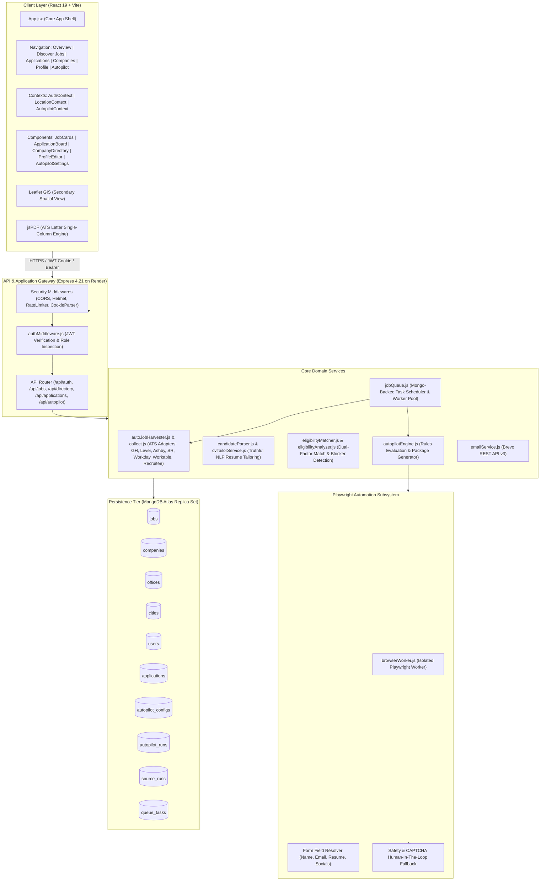
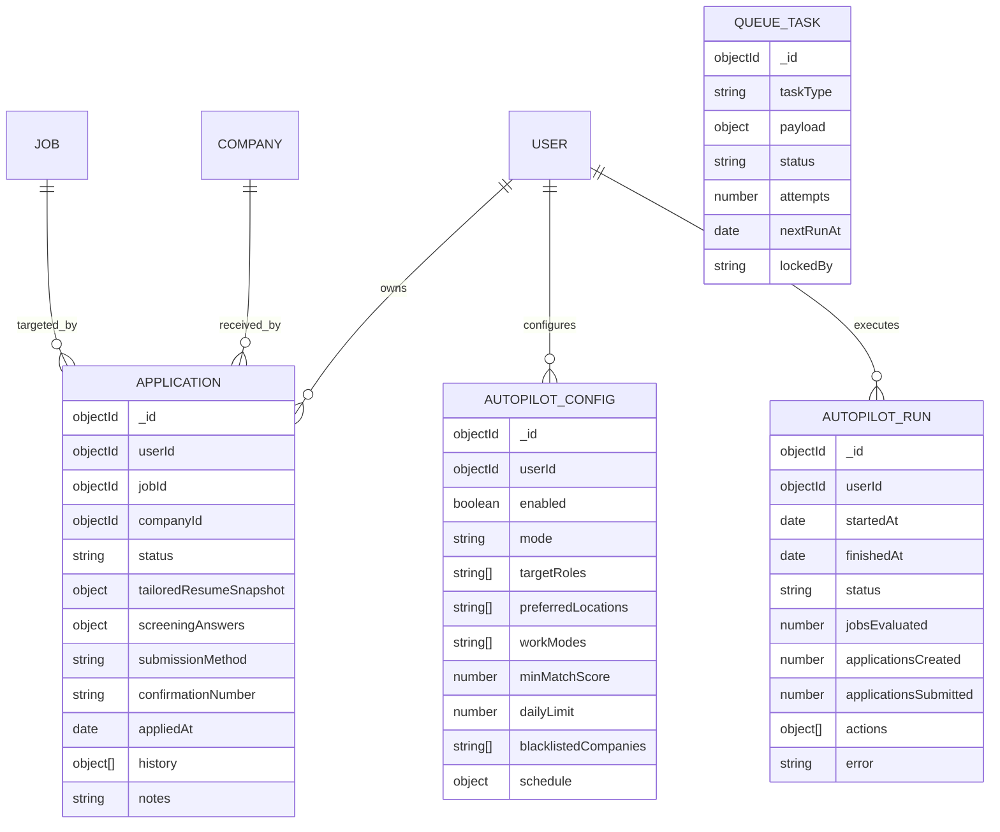

# JobRadar — Proposed System Architecture & Technical Design

> **Document Status:** Approved Engineering Architecture  
> **Target Version:** JobRadar 2.0  
> **Author:** Principal Software Architect & Senior Engineering Team

---

## 1. Architectural Principles & System Topology

JobRadar 2.0 is designed around five core engineering tenets:

1. **Zero-Trust Ingestion & Data Authenticity:** Job postings and company intelligence are ingested directly from official enterprise endpoints and public ATS boards. Stale aggregators and fabricated slugs are strictly disallowed.
2. **Deterministic Precedence over Heuristic Assumptions:** Hard eligibility barriers (such as right-to-work, country residency, and mandatory minimum experience) unconditionally override semantic skill matching.
3. **Absolute Candidate Truthfulness:** Automated resume tailoring and screening answers strictly leverage verified candidate credentials. The system never fabricates skills, projects, or employment history.
4. **Resilient Background Automation:** Automated application workflows operate under explicit user-configured limits, with idempotency guards, structured audit logging, and human-in-the-loop fallbacks for CAPTCHAs or non-standard declarations.
5. **Zero Paid Infrastructure Lock-In:** Core functionalities run entirely on free-tier and open-source infrastructure (Node.js, Express, React, MongoDB Atlas M0, Brevo free tier, OpenStreetMap, Leaflet).

### End-to-End System Topology



---

## 2. Core Subsystems & Component Boundaries

### 2.1 Ingestion & Discovery Subsystem
- **Direct Adapters (`backend/adapters/`):** Dedicated normalization modules for Greenhouse, Lever, Ashby, SmartRecruiters, Workday CXS, Amazon Jobs, Google Careers, Eightfold.ai, Workable, and Recruitee.
- **Career Portal & ATS Detector (`backend/services/atsDetector.js`):** Inspects company career URLs and follow redirects to classify the underlying ATS engine and slug automatically.
- **Rate-Limiting & Host Politeness (`backend/utils/rateLimiter.js`):** Enforces a minimum 1000ms delay per host.
- **Idempotency Rule:** A job is marked `closed` **only** upon a successful HTTP 200 response from that company's board that omits the ID. Network failures log to `SourceRun` and leave active jobs open.

### 2.2 Candidate Intelligence & Truthful Tailoring
- **Master Profile Model:** Stores candidate identity, contact info, residency, verified work experience, projects, education, and classified skills with proficiency levels.
- **Dual-Factor Match Engine:**
  - *Factor 1 (Deterministic Constraints):* Work authorization, country residency, and minimum required experience years. If a candidate fails a hard constraint (e.g. US-only on-site role for an Indian resident), the job is flagged as **HARD BLOCKER** regardless of skill match.
  - *Factor 2 (Semantic Technical Match):* Overlap between candidate competencies and job requirements.
- **Truthful Tailoring Engine:** Injects keywords into project bullets and skills sections **only** if the candidate possesses that competency in their master profile. Generates single-column ATS PDFs via `jsPDF` using the classic Overleaf LaTeX "Jake's Resume" typography and layout.

### 2.3 Application Lifecycle Management
Transitions beyond simple pipeline tracking to support the full 10-stage lifecycle:
```text
[ Discovered ] ──> [ Shortlisted ] ──> [ Resume Ready ] ──> [ Awaiting Approval ] ──> [ Applied ]
                                                                                           │
                     [ Withdrawn ] <─── [ Rejected ] <─── [ Offer ] <─── [ Interview ] <─── [ Assessment ]
```
Every application stores:
- Timestamped audit log of all status transitions.
- The exact tailored resume version used at submission time.
- Pre-filled screening answers.
- External confirmation numbers, recruiter names, and follow-up reminders.

### 2.4 Autopilot & Automation Engine
- **Autonomy Modes:**
  1. *Assisted Mode (Default / Recommended):* Discovers, filters, ranks, and pre-generates tailored resume and answers. Staged under `Awaiting Approval` for 1-click user review and dispatch.
  2. *Autonomous Mode:* For supported ATS boards (Greenhouse, Lever) where allowed, uses Playwright to open the form, populate fields from the verified candidate profile, upload the generated resume, and submit.
- **Safety Gate & Human-In-The-Loop Protocol:**
  - If a CAPTCHA challenge, unexpected question, or legal declaration is detected, the automated runner halts immediately.
  - Takes a DOM snapshot, records the form state, alerts the user, and presents the link for manual completion.
  - Daily submission caps (e.g., maximum 5 or 10 applications per day) prevent account flagging or platform bans.

---

## 3. Database Schema Evolution

### 3.1 Extended & New Collections



---

## 4. Security Architecture & Threat Model

1. **Credential Isolation:**
   - Zero hardcoded fallback secrets. If `process.env.JWT_SECRET` or `process.env.BREVO_API_KEY` are not supplied, the backend fails early with descriptive logs.
2. **SSRF Defense:**
   - Candidate portfolio scrapers resolve hostnames via `node:dns` and reject private IP ranges (RFC 1918, RFC 3927 link-local `169.254.x.x`, loopback `127.0.0.1`, and IPv6 equivalents).
3. **Rate Limiting & Abuse Prevention:**
   - Sliding-window rate limiting on `/api/auth/*` (prevent brute-force OTP attempts) and scraping routes.
4. **Data Privacy & Isolation:**
   - All candidate CVs, master profiles, application records, and autopilot configs are scoped strictly by authenticated `userId`.
   - Cross-tenant data leakage is prevented via mandatory user-ownership filters on all mutating queries.

